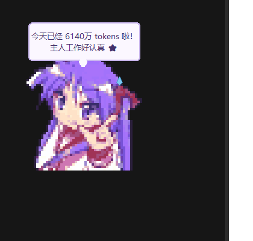

# Kagami酱 🎀

> 常驻桌面的 Q 版像素桌宠，实时记录 [ZCode](https://z.ai) 的 token 用量。
> 原型：幸运星·柊镜（原图像素化转绘）。



## 特性

- 📊 **实时 token 记账** —— 增量解析 ZCode 的模型 I/O 日志，今日 / 近 7 天 / 按模型 / 按会话 / 累计全维度统计
- 🎀 **像素桌宠** —— 48×48 网格像素化转绘（深色描边 + 有限调色板量化，NEAREST 整数倍放大），待机浮动、干活弹跳、烧太快冒汗、没动静打瞌睡（Zzz）、跨过 10 万整倍数里程碑跳起庆祝
- 😤 **傲娇人格** —— 闲聊 / 摸头 / 里程碑全是柊镜语气："哈？！才不是特意在帮你数 token 呢…"
- 🖱 **交互** —— 单击摸头（小心心）· 双击统计面板 · 拖拽摆位 · 悬停速览 · 系统托盘开关 · 桌面快捷方式 / 开机自启
- 🔮 **燃烧预测** —— 按 15 分钟速率外推 2 小时用量，傲娇提醒你节制
- 💰 **成本估算** —— 内置 DeepSeek / GLM 公开单价（宁缺勿错，查不到的模型不显示），可在设置里自定义费率覆盖
- 🛡 **准确性工程** —— requestId 去重防重试双计 · 增量断点续读 · 独立累计账本（日志被清理不丢账）· `--audit` 数据自检
- 🪶 **极轻** —— 桌宠本体纯 Python 标准库，单文件；托盘/图像处理是仅有的两个可选依赖，不碰任何网络

## 快速开始

```bash
pip install pystray pillow     # 可选：托盘图标与精灵生成用
python token_pet.py
```

- 数据来源：`~/.zcode/cli/rollout/model-io-sess_*.jsonl`（ZCode 的模型 I/O 日志，任何 provider 通用）
- 配置与累计账本存于注册表 `HKCU\Software\TokenPet`，卸载即删、无残留文件

## CLI

```bash
python token_pet.py --cli      # 终端统计报告
python token_pet.py --audit    # 数据自检：独立重扫磁盘与内存账核对
```

## 交互一览

| 操作 | 效果 |
|---|---|
| 单击小人 | 摸头（小心心 + 傲娇台词） |
| 双击小人 | 打开 / 关闭统计面板 |
| 拖动小人 | 摆位（自动记忆） |
| 悬停小人 | 今日 / 近 7 天 / 累计速览 |
| 右键小人 | 刷新、置顶、自启、成本设置、退出 |
| 托盘左键 | 显示 / 隐藏（隐藏后仍在后台记账） |

## 换成你自己的形象

把你自己的 Q 版白底图命名为 `original_image.jpg` 放到 `gen_pixelate.py`
同目录，按需调整 `GRID`（网格粗细）、`COLORS`（调色板色数）、`SCALE`
（放大倍数），运行 `python gen_pixelate.py` 即可重新生成双帧精灵。

> 默认精灵图由用户提供的图片转绘而来，原角色版权归原权利方，仅供个人使用。

## License

MIT
