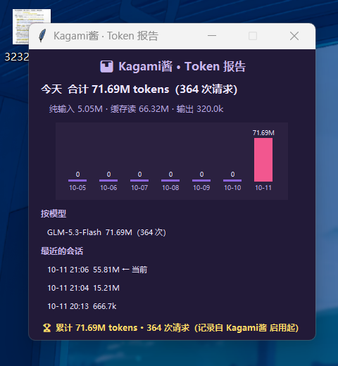

<div align="center">

# 🎀 Kagami酱

**常驻桌面的傲娇像素桌宠 · 实时记录 ZCode 的 token 用量**

原型：幸运星·柊镜（原图像素化转绘）

[](https://www.python.org/)
[](https://github.com/Atomsk-m4lu/kagami-chan)
[](LICENSE)
[](https://github.com/Atomsk-m4lu/kagami-chan/stargazers)

*纯 Python 标准库 · 单文件 · 不碰任何网络*

</div>

---

<div align="center">
&nbsp;&nbsp;

</div>

## ✨ 为什么是她

大多数 token 监控工具只有数字，大多数桌宠只有萌——**Kagami酱 两者都有**：
她住在你的屏幕角落，看着 agent 干活，把每一次模型调用都记进账本，
烧得快了会冒汗，没动静会打瞌睡，跨过 10 万整倍数时会跳起来夸你——
用柊镜的方式。

## 📊 记账能力

| 维度 | 说明 |
|---|---|
| 今日 / 近 7 天 | 纯输入 · 缓存读 · 输出三分口径，缓存命中一眼可见 |
| 按模型 / 按会话 | 换 provider 不用改配置，自动分桶，当前会话带标记 |
| 累计账本 | 独立记账（注册表），**日志被清理也不丢账** |
| 燃烧预测 | 按 15 分钟速率外推 2 小时用量，傲娇预警 |
| 成本估算 | 内置 DeepSeek / GLM 公开单价，可自定义费率，查不到的模型宁缺勿错 |
| 数据自检 | `--audit` 独立重扫磁盘与内存账核对，账目可验证 |

**准确性三防线**（参考 [ccusage](https://github.com/ryoppippi/ccusage) 的思路）：
`requestId` 去重防重试双计 → 增量断点续读（tail 半行缓冲）→ 独立账本 + 自检核对。

## 🎀 桌宠状态机

| 状态 | 触发 | 表现 |
|---|---|---|
| 💤 睡觉 | 10 分钟无请求 | Zzz 慢浮 |
| 🙂 待机 | 低负载 | 轻轻浮动 + 马尾摇摆 |
| ⚡ 干活 | 请求活跃 | 快速弹跳 |
| 😰 冒汗 | > 3 万 tokens/分钟 | 汗滴 + 高速抖动 |
| ⭐ 庆祝 | 今日每跨 10 万整倍数 | 星星 + 跳跃 |

闲聊、摸头、里程碑全部柊镜语气——"哈？！才不是特意在帮你数 token 呢…"

## 🚀 快速开始

```bash
pip install pystray pillow     # 可选依赖：托盘图标与精灵生成
python token_pet.py
```

数据来源 `~/.zcode/cli/rollout/model-io-sess_*.jsonl`（ZCode 模型 I/O 日志，
**任何 provider 通用**，切 GLM / DeepSeek 无需任何配置）。

```bash
python token_pet.py --cli      # 终端统计报告
python token_pet.py --audit    # 数据自检
```

## 🖱 交互一览

| 操作 | 效果 |
|---|---|
| 单击小人 | 摸头（小心心 + 傲娇台词） |
| 双击小人 | 统计面板 |
| 拖动小人 | 摆位（自动记忆） |
| 悬停小人 | 今日 / 近 7 天 / 累计速览 |
| 右键小人 / 托盘 | 刷新 · 置顶 · 开机自启 · 成本设置 · 显示隐藏 · 退出 |

## 🧩 工作原理

```
ZCode 模型调用
      │  写入
      ▼
~/.zcode/cli/rollout/*.jsonl        ← 每次调用一行（含 usage）
      │  增量扫描（offset 断点续读 + requestId 去重）
      ▼
Engine ──► 今日/7天/模型/会话聚合      ──► 气泡 · tooltip · 面板
      └──► lifetime 累计账本（注册表）  ──► 状态机 → 桌宠情绪
```

## 🎨 换成你自己的形象

把你自己的 Q 版白底图命名为 `original_image.jpg` 放到 `gen_pixelate.py`
同目录，调整 `GRID`（网格粗细）/ `COLORS`（色板数）/ `SCALE`（放大倍数），
运行 `python gen_pixelate.py` 重新生成双帧精灵。

> 默认精灵图由用户提供的图片转绘而来，原角色版权归原权利方，仅供个人使用。

## 🗺 Roadmap

- [ ] 成本按模型分别计价（当前为统一费率）
- [ ] 支持 Claude Code 等其他 agent 的日志源
- [ ] 数据导出 CSV / 月度报表
- [ ] 摸头升级：更多帧动画与好感度系统

## 🙏 致谢

- 记账与去重思路参考 [ccusage](https://github.com/ryoppippi/ccusage)
- 灵感同类：[clawd-on-desk](https://github.com/rullerzhou-afk/clawd-on-desk)、
  [BongoCat](https://github.com/ayangweb/BongoCat)

## License

[MIT](LICENSE) © 2026 Atomsk-m4lu
